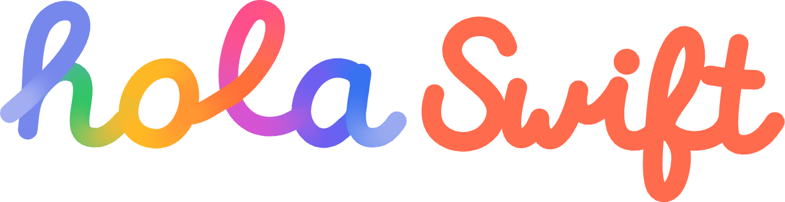

  <picture>
    
  </picture>

<b>Presentaciones con la marca de hola Swift, hechas con Claude.</b> 
<a href="https://holaswift.com/presentaciones/">holaswift.com/presentaciones</a>

---

¿Vais a dar una charla en hola Swift? Os ahorramos la parte de pelearse con las diapositivas. Esta skill le enseña a Claude a
hacer presentaciones con nuestra marca: el "hola" en tubo 3D, titulares grandes, muy poco texto y una idea por diapositiva.
Se le pide como a una persona:

> «Hazme las diapositivas de mi charla sobre accesibilidad en SwiftUI, el miércoles 20 de enero a las 19:00.»

> «Mándame la plantilla para ponentes con mi nombre y el tema Swift Testing.»

> «Prepara las pantallas de espera y el programa del encuentro.»

Claude os devuelve un `.pptx` que se abre y se edita en Keynote, PowerPoint o Google Slides.

## Empezad aquí

**1. Instalad las fuentes (una vez).** Abrid los archivos de [`fuentes/`](fuentes) con doble clic y pulsad «Instalar». Son
Inter e Inter Display, con licencia libre. Sin ellas, Keynote y PowerPoint ponen otra parecida.

**2. Instalad la skill** en el asistente que uséis:

- **claude.ai (web o app).** Descargad
  [holaswift-presentaciones.skill](https://github.com/holaswift/presentaciones/releases/download/descargas/holaswift-presentaciones.skill)
  y subidlo en Ajustes › Capacidades › Skills › Subir skill. Tiene que estar activada la ejecución de código.
- **Claude Code** (terminal o pestaña Code de la app de escritorio). Así se actualiza sola desde este repositorio:

      /plugin marketplace add holaswift/presentaciones
      /plugin install presentaciones@holaswift

  Para recibir las actualizaciones automáticamente: `/plugin` › Marketplaces › `holaswift` › activar la actualización automática.
- **Codex, Gemini CLI, Cursor y otros**, con el instalador de skills (necesita Node.js):

      npx skills add holaswift/presentaciones

**3. Pedídsela a Claude.** Con el tema, la fecha y vuestro nombre basta. Lo que no sepa lo deja `[entre corchetes]` para que lo
completéis.

¿Preferís empezar a mano? La [plantilla para ponentes](https://github.com/holaswift/presentaciones/releases/download/descargas/plantilla-ponentes.pptx)
trae huecos y notas que explican cada diapositiva.

## Qué sabe hacer

- **La charla del mes:** portada, "hola + tema", contenido, preguntas y cierre.
- **La plantilla para ponentes invitados,** con vuestro nombre y tema.
- **Las pantallas del encuentro o del directo:** espera, pausa, programa y logos de patrocinadores.
- **El recap de una charla,** para exportar a PDF y compartir en LinkedIn o Discord.
- **Presentaciones para patrocinadores.**

Hay 14 tipos de diapositiva y tres temas: claro, oscuro y color. Junto a cada `.pptx`, Claude entrega el guion (`.json`): para
cambiar algo, pedidle que edite el guion y la vuelva a generar.

En [`ejemplos/`](ejemplos) hay una charla completa, la plantilla para ponentes y las pantallas del encuentro.

Más formas de instalarla

**Claude Code desde la terminal**, sin abrir Claude:

    claude plugin marketplace add holaswift/presentaciones
    claude plugin install presentaciones@holaswift

Para actualizar a mano: `claude plugin marketplace update holaswift` y después `claude plugin update presentaciones@holaswift`.

**Gemini CLI**, con su propio comando (comprobad las opciones con `gemini skills --help`):

    gemini skills install https://github.com/holaswift/presentaciones --path skills/holaswift-presentaciones

**A mano:** copiad la carpeta `skills/holaswift-presentaciones` a la carpeta de skills de vuestro asistente
(en Claude Code, `~/.claude/skills/`).

La skill genera el `.pptx` con Python: la primera vez puede que haga falta `pip install python-pptx pillow numpy`.

Para quien mantiene este repositorio

| Ruta | Qué es |
|---|---|
| `skills/holaswift-presentaciones/` | La skill (la fuente). Es lo único que instalan Claude Code, `npx skills` y Gemini |
| `skills/.claude-plugin/plugin.json` | El plugin de Claude Code que contiene la skill (nombre `presentaciones`) |
| `.claude-plugin/marketplace.json` | El marketplace `holaswift`, que apunta al plugin de `skills/` |
| `fuentes/`, `ejemplos/` | Descargas para ponentes. No forman parte del plugin |
| `empaquetar.sh` | Genera `holaswift-presentaciones.skill` (el ZIP para claude.ai) a partir de la skill |
| `index.html`, `web/` | La página https://holaswift.com/presentaciones/, con GitHub Pages desde `main` (raíz). Las fuentes y el logo los pide a la web principal (`/assets/…`) |

- **No subáis el `.skill` al repositorio.** La Action `.github/workflows/descargas.yml` lo genera con `empaquetar.sh` en cada
  cambio de `main` y lo publica, junto con las fuentes y las plantillas, en la release `descargas`, que es lo que enlaza la web.
  No cambiéis los nombres de `ejemplos/` sin revisar esa Action.
- **Versiones:** `plugin.json` no lleva `version` a propósito. Así cada commit en `main` cuenta como una versión nueva y llega a
  quien tenga la actualización automática activada.
- Antes de subir cambios en la skill o en los JSON, comprobadlos con `claude plugin validate .` y `claude plugin validate skills`.

hola Swift es una comunidad independiente, sin relación oficial con Apple Inc. Swift y Apple son marcas de Apple Inc.
